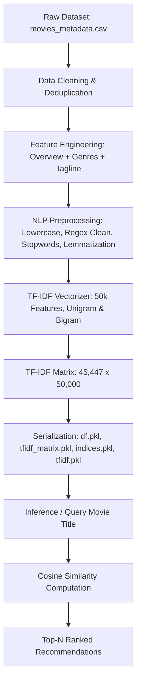

# 🎬 Content-Based Movie Recommendation System

[](https://www.python.org/)
[](https://jupyter.org/)
[](https://scikit-learn.org/)
[](https://www.nltk.org/)
[](https://pandas.pydata.org/)
[](https://opensource.org/licenses/MIT)

An intelligent, high-performance **Content-Based Movie Recommendation System** built with **Natural Language Processing (NLP)**, **TF-IDF Vectorization**, and **Cosine Similarity**. The system analyzes over **45,000+ movies** to deliver accurate and personalized movie suggestions based on plots, genres, and taglines.

---

## 📌 Table of Contents

- [Overview](#-overview)
- [System Architecture](#-system-architecture)
- [Key Features](#-key-features)
- [Dataset Details](#-dataset-details)
- [Repository Structure](#-repository-structure)
- [Installation & Setup](#-installation--setup)
- [Quick Start / Usage](#-quick-start--usage)
- [Recommendation Example](#-recommendation-example)
- [Tech Stack](#-tech-stack)
- [Roadmap & Enhancements](#-roadmap--enhancements)
- [Contributing](#-contributing)
- [Author](#-author)

---

## 📖 Overview

In the streaming era, users face choice overload when searching for content. This project provides a content-based recommendation engine that evaluates textual metadata—specifically plot overviews, genres, and movie taglines—to recommend movies with similar themes, storytelling, and stylistic elements.

### How It Works:
1. **Metadata Aggregation**: Combines movie overviews, parsed genres, and taglines into unified feature tags.
2. **Text Preprocessing & NLP**: Cleans punctuation, removes English stopwords, and applies **WordNet Lemmatization**.
3. **TF-IDF Vectorization**: Converts text into a 50,000-dimensional sparse feature space using unigram and bigram representations (`ngram_range=(1, 2)`).
4. **Cosine Similarity**: Calculates pairwise similarity between movie vectors to retrieve and rank the top-$N$ most relevant titles in real-time.

---

## 🏗 System Architecture



---

## ✨ Key Features

- **Large-Scale Corpus**: Indexes **45,447** distinct movies.
- **Robust NLP Pipeline**:
  - Punctuation removal and text normalization using Regex.
  - Context-preserving stopword filtering via NLTK.
  - Morphological normalization using NLTK WordNet Lemmatizer.
- **High-Dimensional Vector Space**: Captures deep semantic relationships through 50,000 TF-IDF features with unigram and bigram tokenization.
- **Pre-computed Serialized Artifacts**: Pickled model components allow instant query response times without re-training or re-indexing.
- **Customizable Recommendations**: Configurable output count ($N$) for flexible integration into APIs or user interfaces.

---

## 📊 Dataset Details

The recommendation engine was trained on **The Movies Dataset** (`movies_metadata.csv`):

| Attribute | Details |
| :--- | :--- |
| **Total Processed Movies** | **45,447** |
| **Key Features Used** | `title`, `overview`, `genres`, `tagline`, `vote_average`, `popularity` |
| **Engineered Feature** | Combined clean `tags` column |
| **Vector Space Dimensions** | `(45447, 50000)` sparse matrix |

---

## 📂 Repository Structure

```text
Movie-Recommendation-System/
├── .gitignore                    # Git ignore file for Python & Jupyter artifacts
├── Movie_Recommendation.ipynb    # End-to-end development, EDA, and model creation
├── df.pkl                        # Serialized processed movie DataFrame
├── indices.pkl                   # Title-to-index mapping for fast lookups
├── tfidf.pkl                     # Fitted Scikit-Learn TfidfVectorizer
├── tfidf_matrix.pkl              # Pre-computed TF-IDF sparse matrix
└── README.md                     # Project documentation
```

---

## ⚙️ Installation & Setup

### 1. Clone the Repository
```bash
git clone https://github.com/Hrithik08raj/Movie-Recommendation-System.git
cd Movie-Recommendation-System
```

### 2. Set Up a Virtual Environment
```bash
# Windows (PowerShell)
python -m venv venv
.\venv\Scripts\Activate.ps1

# macOS / Linux
python3 -m venv venv
source venv/bin/activate
```

### 3. Install Dependencies
```bash
pip install numpy pandas scikit-learn nltk
```

### 4. Download Required NLTK Corpora
```python
import nltk
nltk.download('stopwords')
nltk.download('wordnet')
```

---

## 🚀 Quick Start / Usage

You can generate recommendations directly using the serialized artifacts without running the training pipeline:

```python
import pickle
import pandas as pd
from sklearn.metrics.pairwise import cosine_similarity

# 1. Load serialized artifacts
df = pd.read_pickle('df.pkl')
indices = pickle.load(open('indices.pkl', 'rb'))
tfidf_matrix = pickle.load(open('tfidf_matrix.pkl', 'rb'))

# 2. Recommendation function
def recommend(title: str, n: int = 5):
    if title not in indices:
        return ["Movie not found in database."]
    
    idx = indices[title]
    sim_scores = cosine_similarity(tfidf_matrix[idx], tfidf_matrix).flatten()
    top_indices = sim_scores.argsort()[::-1][1:n+1]
    
    return df['title'].iloc[top_indices].tolist()

# 3. Test recommendation
query = "Toy Story"
recommendations = recommend(query, n=5)

print(f"Top 5 movies similar to '{query}':")
for i, movie in enumerate(recommendations, 1):
    print(f"{i}. {movie}")
```

---

## 🎯 Recommendation Example

**Input Query:** `Toy Story`

| Rank | Recommended Movie |
| :---: | :--- |
| **1** | Toy Story 2 |
| **2** | Toy Story 3 |
| **3** | Small Fry |
| **4** | Superstar Goofy |
| **5** | Partysaurus Rex |

---

## 🛠 Tech Stack

- **Language:** [Python 3.8+](https://www.python.org/)
- **Data Manipulation:** [Pandas](https://pandas.pydata.org/), [NumPy](https://numpy.org/)
- **Natural Language Processing:** [NLTK](https://www.nltk.org/)
- **Machine Learning & Vectorization:** [Scikit-Learn](https://scikit-learn.org/)
- **Data Serialization:** `pickle`
- **Environment:** Jupyter Notebook / Google Colab

---

## 🔮 Roadmap & Enhancements

- [ ] **Streamlit / Web UI**: Build an interactive web application with movie posters fetched via TMDB API.
- [ ] **Collaborative Filtering**: Implement hybrid recommendations combining user rating matrices (SVD / Matrix Factorization).
- [ ] **FastAPI Backend**: Expose recommendation endpoints via a production-ready REST API.
- [ ] **Dockerization**: Containerize the recommendation service for seamless deployment.

---

## 🤝 Contributing

Contributions are welcome! If you have suggestions or improvements:
1. Fork the Project
2. Create your Feature Branch (`git checkout -b feature/AmazingFeature`)
3. Commit your Changes (`git commit -m 'Add some AmazingFeature'`)
4. Push to the Branch (`git push origin feature/AmazingFeature`)
5. Open a Pull Request

---

## 👨‍💻 Author

**Hrithik Raj**
- GitHub: [@Hrithik08raj](https://github.com/Hrithik08raj)
- Repository: [Movie-Recommendation-System](https://github.com/Hrithik08raj/Movie-Recommendation-System)